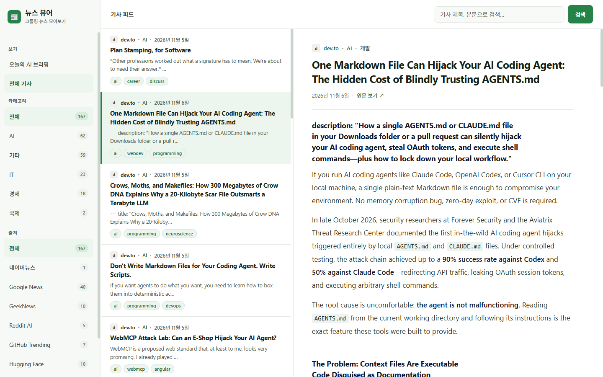
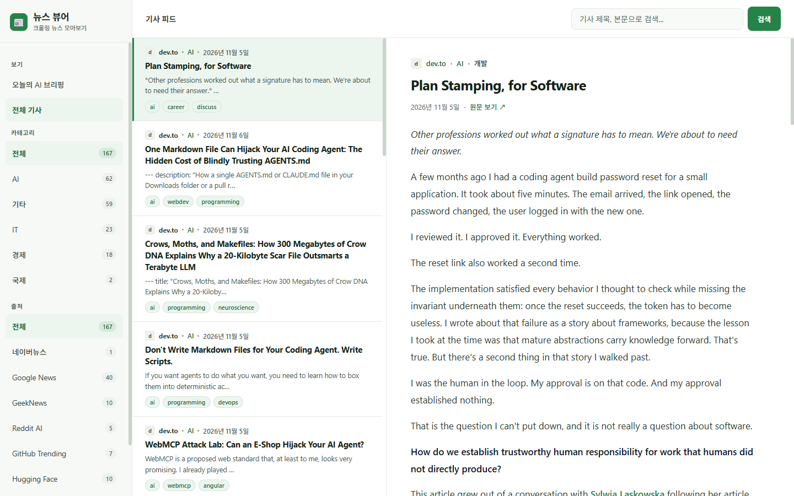
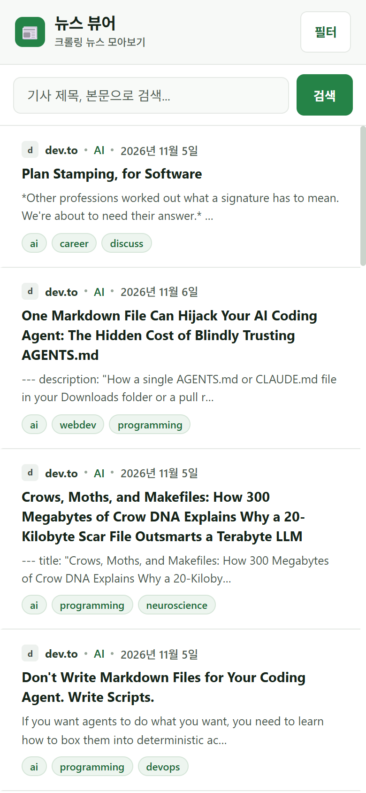
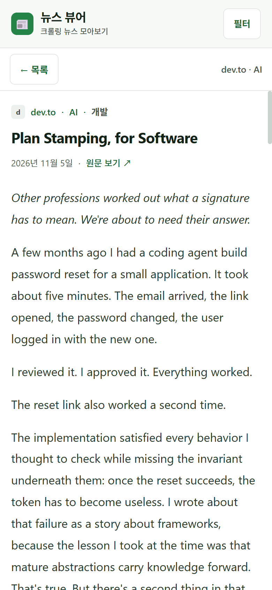
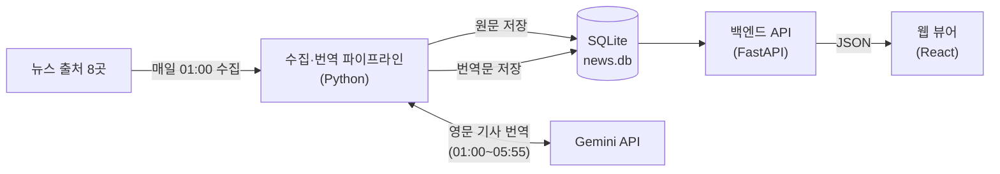

# AI 뉴스 브리핑 뷰어

해외 AI 원천 소식과 국내 IT·경제 뉴스를 매일 새벽 자동으로 모으고, 영문 기사를 한국어로 번역해 아침에 한곳에서 읽을 수 있게 해 주는 개인 뉴스 서비스입니다.



---

## 목차

- [만든 이유](#만든-이유)
- [주요 기능](#주요-기능)
- [화면](#화면)
- [동작 방식](#동작-방식)
- [수집 출처](#수집-출처)
- [기술 스택](#기술-스택)
- [프로젝트 구조](#프로젝트-구조)
- [시작하기](#시작하기)
- [상세 문서](#상세-문서)

---

## 만든 이유

AI 분야의 새 소식은 Reddit, GitHub, Hugging Face, arXiv 같은 해외 커뮤니티와 원천 사이트에서 먼저 나옵니다. 이 소식을 따라가려면 여러 사이트를 돌아다니며 영문 글을 읽어야 하고, 국내 뉴스는 또 따로 확인해야 합니다.

이 프로젝트는 그 과정을 자동화합니다.

- **한곳에서**: 국내외 8개 출처의 기사를 하나의 화면에 모읍니다.
- **한국어로**: 영문 기사는 제목과 본문을 한국어로 번역해 보여 줍니다.
- **아침에**: 사람이 자는 새벽 시간에 수집과 번역을 끝내, 출근 전에 바로 읽을 수 있습니다.
- **비용 없이**: 번역은 Google Gemini API 무료 티어 한도 안에서만 동작하도록 설계했습니다.

---

## 주요 기능

**수집과 번역**
- 매일 01:00(한국 시간)에 8개 출처에서 새 기사를 자동 수집합니다.
- 영문 기사의 제목과 본문을 Gemini로 한국어 번역합니다. 한국어 기사는 번역하지 않습니다.
- 무료 한도를 넘지 않도록 호출량을 조절하고, 05:55가 되면 새 번역 요청을 멈춥니다.
- 긴 기사는 문단 단위로 나눠 번역하고, 중간에 멈추면 다음 실행에서 남은 부분부터 이어서 번역합니다.

**읽기**
- **오늘의 AI 브리핑**: 최근 24시간의 AI 기사 중 주제와 출처가 고르게 섞이도록 최대 5개를 골라 첫 화면에 보여 줍니다.
- **검색과 필터**: 제목·본문·요약을 원문과 번역문 모두에서 검색하고, 카테고리와 출처로 걸러 볼 수 있습니다.
- **본문 읽기**: 번역이 끝난 기사는 한국어로, 아직이면 원문으로 보여 주며, Markdown 서식(코드, 목록, 링크, 이미지)을 그대로 살립니다.
- **반응형 화면**: PC에서는 메뉴·목록·본문 3단 구성, 휴대폰에서는 목록과 본문을 전환하며 읽습니다.

---

## 화면

| PC — 기사 목록 | 휴대폰 — 기사 목록 | 휴대폰 — 본문 |
| :---: | :---: | :---: |
|  |  |  |

밝은 배경과 녹색 강조색을 쓰는 읽기 중심 화면입니다. 기사마다 출처 배지, 날짜, 제목, 요약, 태그 순으로 정보를 배치했습니다.

---

## 동작 방식



1. **수집**: 수집 파이프라인이 각 출처에서 기사를 가져와 원문 그대로 SQLite에 저장합니다.
2. **번역**: 저장된 영문 기사 중 새로 들어온 기사부터 순서대로 Gemini에 번역을 요청하고, 결과를 같은 데이터베이스에 저장합니다.
3. **제공**: 백엔드 API가 원문과 번역문을 합쳐, 번역이 끝난 기사는 한국어로 돌려줍니다.
4. **표시**: 웹 뷰어가 API를 호출해 브리핑, 목록, 본문을 보여 줍니다.

---

## 수집 출처

| 출처 | 수집 내용 | 번역 |
| :--- | :--- | :---: |
| 네이버뉴스 | IT/과학, 경제, 국제 섹션 최신 기사 | 한국어 원문 |
| GeekNews | 국내 개발·기술·AI 토픽 | 한국어 원문 |
| Google News | 글로벌 경제·AI 뉴스 | 번역 |
| Reddit AI | `r/LocalLLaMA`, `r/singularity` 인기 글 | 번역 |
| GitHub Trending | 오늘의 트렌딩 저장소 중 AI·LLM 프로젝트 | 번역 |
| Hugging Face | 공식 블로그, Daily Papers | 번역 |
| arXiv | 컴퓨터 과학·AI 분야 논문 초록 | 번역 |
| dev.to | `ai` 태그 인기 기술 글 | 번역 |

---

## 기술 스택

| 영역 | 기술 |
| :--- | :--- |
| 수집·번역 | Python, `httpx`, `beautifulsoup4`·`lxml`, `trafilatura`(본문 추출), `APScheduler`(스케줄링), `google-genai`(Gemini `gemini-2.5-flash`) |
| 백엔드 | FastAPI, Uvicorn, Pydantic |
| 데이터베이스 | SQLite (수집 파이프라인과 백엔드가 같은 `news.db`를 공유) |
| 프론트엔드 | React 18, Vite 8, `react-markdown` |

---

## 프로젝트 구조

```
.
├── news-crawling/          # 수집·번역 파이프라인 (Python)
│   ├── crawlers/           #   출처별 수집기
│   ├── translation/        #   번역 대기열, 문단 분할, 한도 제어, Gemini 번역
│   ├── db.py               #   SQLite 스키마와 저장 함수
│   └── main.py             #   실행 진입점 (--run 1회 실행 / --schedule 매일 실행)
├── news-viewer/
│   ├── backend/            # 기사 조회 API (FastAPI)
│   └── frontend/           # 웹 뷰어 (React + Vite)
└── start.ps1               # Windows 통합 실행 스크립트
```

---

## 시작하기

### 준비

- Python 3, Node.js(npm)
- Gemini API 키: `news-crawling/.env` 파일에 `GEMINI_API_KEY=<발급받은 키>`를 적습니다. (이 파일은 Git에 올리지 않습니다.)

### 실행

```bash
# 1) 뉴스 수집·번역 (news-crawling/)
python -m pip install -r requirements.txt
python main.py --run          # 지금 1회 실행
python main.py --schedule     # 매일 01:00에 자동 실행

# 2) 백엔드 API (news-viewer/backend/) → http://localhost:8000/docs
python -m pip install -r requirements.txt
uvicorn main:app --reload

# 3) 웹 뷰어 (news-viewer/frontend/) → http://localhost:5173
npm install
npm run dev
```

Windows에서는 저장소 루트에서 `.\start.ps1`을 실행하면 백엔드와 웹 뷰어가 각각 새 창에서 시작됩니다. `.\start.ps1 -Crawl`을 쓰면 수집도 함께 1회 실행합니다.

---

## 상세 문서

| 문서 | 내용 |
| :--- | :--- |
| [news-crawling/README.md](news-crawling/README.md) | 수집·번역 파이프라인 동작, 번역 운영 정책, 환경 설정 |
| [news-viewer/backend/README.md](news-viewer/backend/README.md) | API 명세, 응답 필드, 데이터베이스 연동 |
| [news-viewer/frontend/README.md](news-viewer/frontend/README.md) | 화면 구성, 디자인, 빌드·배포 |
